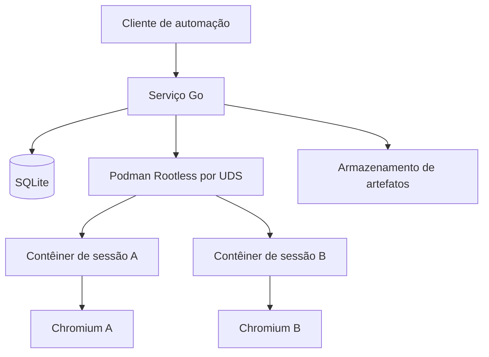

<!-- A-BIOMA-DOC-STANDARD -->
# ARQ-001 — Visão geral e limites do sistema

**Situação:** Proposto.

## Objetivo

Isolar cada navegação Chromium em um contêiner Podman Rootless separado, comandado por um serviço Go. O serviço fará o gerenciamento das imagens, sessões, tarefas e prazo de retenção; o SQLite guardará apenas metadados operacionais.

## Componentes

| Componente | Responsabilidade | Local |
| --- | --- | --- |
| Serviço InsulaTestBrowser (Go) | Orquestrar sessões, validar operações, aplicar políticas e recuperar execuções | Host, usuário sem privilégios |
| API Podman | Criar, inspecionar, parar e excluir contêineres; preparar imagens OCI | Socket Unix rootless, host |
| Contêiner por sessão | Executar Chromium e um mecanismo de controle de navegação | Contêiner descartável |
| Chromium | Abrir páginas e executar operações por Chrome DevTools Protocol (CDP) | Dentro de cada contêiner |
| SQLite | Estado, vínculos com contêineres/imagens, tempos e retenção | Host; nunca montado no contêiner |
| Artefatos | Capturas, downloads e logs, sob políticas de expiração | Diretório privado, fora do perfil |

A imagem base é reutilizável; o perfil Chromium, os diretórios de downloads e o armazenamento gravável de cada sessão **não** são compartilhados.

## Limites e interfaces

- O serviço controla Podman pelo socket Unix do usuário dedicado. Não expõe seu socket aos contêineres.
- A interface externa do InsulaTestBrowser será local, preferencialmente UDS; o formato de mensagens e a CLI ainda serão definidos.
- O transporte do comando de navegação até Chromium (CDP por pipe, agente interno ou outro meio sem porta pública de depuração) permanece **não verificado** e precisa de protótipo.
- Acesso a sites depende de política de saída de rede. O contêiner não recebe acesso irrestrito a redes privadas/host por padrão.
- O SQLite é banco de metadados, não local de armazenamento de cookies, credenciais ou dados de páginas.

## Implantação desejada

Linux/Debian 13, Go, Podman em modo rootless e runtime OCI compatível; usuário de serviço dedicado, com subuid/subgid configurados. A instalação do Chromium no host não é necessária: o navegador será empacotado na imagem OCI.

## Referências

- [Segurança](ARQ-002-seguranca.md)
- [Imagens Chromium](ARQ-003-imagens-chromium.md)
- [Persistência](../persistencia/PERS-001-sessoes-sqlite.md)
- [Fluxo de sessão](../fluxos/FLUX-001-ciclo-de-vida.md)
- [Documentação do Podman](https://docs.podman.io/en/stable/markdown/podman.1.html)
