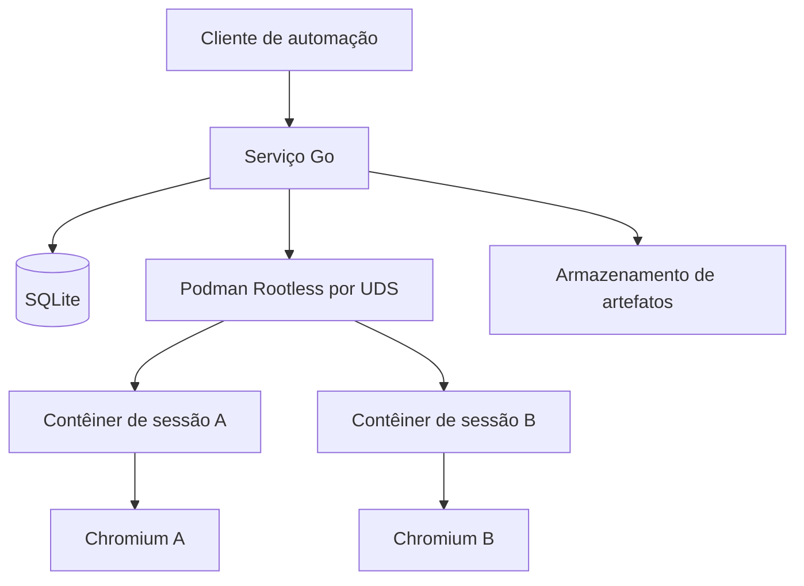

<!-- A-BIOMA-DOC-STANDARD -->
# ARQ-001 — Visão geral e limites do sistema

**Situação:** Proposto.

## Objetivo

Isolar cada navegação Chromium em um contêiner Podman Rootless separado, comandado por um serviço Go. O serviço fará o gerenciamento das imagens, sessões, tarefas e prazo de retenção; o SQLite guardará apenas metadados operacionais.

## Componentes

| Componente | Responsabilidade | Local |
| --- | --- | --- |
| Executor Starlark supervisionado | Interpreta scripts de navegação gerados por LLM, em processo auxiliar com limites e somente a API permitida | Host, processo restrito |
| Serviço InsulaTestBrowser (Go) | Carregar configuração, orquestrar sessões, validar operações, aplicar políticas e recuperar execuções | Host, usuário sem privilégios |
| Arquivo `config.yaml` | Definir SQLite, acesso, credenciais por referência e perfis de imagem/preparação | Pasta do executável ou pasta indicada por argumento, host |
| API Podman | Criar, inspecionar, parar e excluir contêineres; preparar imagens OCI | Socket Unix rootless, host |
| Contêiner por sessão | Executar Chromium e um mecanismo de controle de navegação | Contêiner descartável |
| Contêiner de preparação | Aplicar instruções aprovadas e permitir captura de imagem OCI reutilizável, sem navegar em sites de usuários | Contêiner isolado e temporário |
| Chromium | Abrir páginas e executar operações por Chrome DevTools Protocol (CDP) | Dentro de cada contêiner |
| SQLite | Estado, vínculos com contêineres/imagens, tempos e retenção | Host; nunca montado no contêiner |
| Artefatos | Capturas, downloads e logs, sob políticas de expiração | Diretório privado, fora do perfil |

A imagem base é reutilizável; o perfil Chromium, os diretórios de downloads e o armazenamento gravável de cada sessão **não** são compartilhados. O serviço seleciona o perfil por `config.yaml`: uma imagem existente gera um novo contêiner descartável; a preparação de ambiente ocorre em contêiner próprio, separado das sessões de navegação.

## Execução de scripts (proposta)

O serviço poderá executar arquivos Starlark `.star` que chamam os módulos `browser`, `artifacts` e `job`, sem conceder acesso geral ao sistema operacional. A LLM gera o script a partir de uma URL e de inspeções reais do DOM; não controla diretamente o Podman nem participa da execução. Limites, cancelamento e limpeza pertencem ao serviço Go. Consulte [ARQ-004](ARQ-004-motor-starlark.md), [CONTR-002](../contratos/CONTR-002-api-starlark.md) e [PROMPT-001](../prompts/PROMPT-001-geracao-starlark.md). Nenhum desses componentes está implementado.

## Limites e interfaces

- O serviço controla Podman pelo socket Unix do usuário dedicado. Não expõe seu socket aos contêineres.
- A interface externa do InsulaTestBrowser será local, preferencialmente UDS; o formato de mensagens e a CLI ainda serão definidos.
- O transporte do comando de navegação até Chromium (CDP por pipe, agente interno ou outro meio sem porta pública de depuração) permanece **não verificado** e precisa de protótipo.
- Acesso a sites depende de política de saída de rede. O contêiner não recebe acesso irrestrito a redes privadas/host por padrão.
- O SQLite é banco de metadados, não local de armazenamento de cookies, credenciais ou dados de páginas.
- O binário localiza `config.yaml` ao lado do executável ou na pasta especificada em `--config-dir`. O arquivo indica o caminho do SQLite, controles de acesso, referências de credenciais, montagens e perfis de criação ou clonagem a partir de imagem.
- A imagem salva a partir de um contêiner de **preparação** não pode incluir dados de navegação nem segredos. As montagens das sessões continuam exclusivas.

## Implantação desejada

Linux/Debian 13, Go, Podman em modo rootless e runtime OCI compatível; usuário de serviço dedicado, com subuid/subgid configurados. A instalação do Chromium no host não é necessária: o navegador será empacotado na imagem OCI.

## Referências

- [Segurança](ARQ-002-seguranca.md)
- [Imagens Chromium](ARQ-003-imagens-chromium.md)
- [Configuração centralizada](../referencia/REF-001-configuracao.md)
- [Preparação de imagem](../fluxos/FLUX-002-preparacao-imagem.md)
- [Persistência](../persistencia/PERS-001-sessoes-sqlite.md)
- [Fluxo de sessão](../fluxos/FLUX-001-ciclo-de-vida.md)
- [Documentação do Podman](https://docs.podman.io/en/stable/markdown/podman.1.html)
