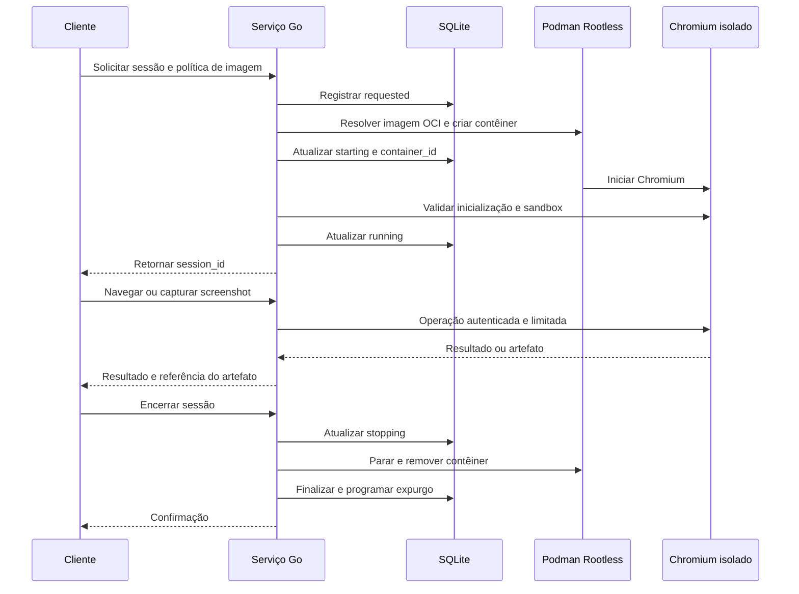

<!-- A-BIOMA-DOC-STANDARD -->
# FLUX-001 — Ciclo de vida de uma sessão

**Estado:** Proposto.  
**Versão aprovada:** nenhuma.

## Objetivo

Orquestrar a criação, a navegação, a finalização e o descarte de um contêiner Chromium por sessão, persistindo o estado mínimo no SQLite.

## Pré-condições

- Serviço Go autorizado a acessar o Podman Rootless por socket Unix.
- `config.yaml` localizado e validado (perfis, SQLite, acesso e retenção).
- Imagem Chromium verificada e disponível no cache ou criada por política de versão. Para preparação e snapshot de novas imagens, consultar [FLUX-002](FLUX-002-preparacao-imagem.md).
- Recursos de CPU, RAM, processos, rede e armazenamento disponíveis.
- Compatibilidade do sandbox Chromium verificada para a imagem e o host.

## Estados propostos

| Estado | Significado |
| --- | --- |
| `requested` | Solicitação registrada; contêiner ainda não criado |
| `starting` | Imagem resolvida e contêiner sendo preparado |
| `running` | Chromium validado e apto a executar operações |
| `stopping` | Encerramento e remoção em andamento |
| `finished` | Encerramento bem-sucedido |
| `failed` | Falha; exige limpeza/reconciliação |
| `expired` | Sessão finalizada por tempo limite |

Os estados terminais `finished`, `failed` e `expired` preservam somente metadados permitidos durante a retenção. Exclusão dos dados não significa apagar imediatamente o registro de erro antes de tentar novamente a limpeza.

## Fluxo principal

O trecho Serviço Go → Chromium representa um **canal conceitual**. O transporte concreto CDP/agente/pipe ainda não foi selecionado.

## Exceções e recuperação

1. Se a imagem não for validada, não criar sessão executável; registrar erro.
2. Se o contêiner iniciar sem sandbox Chromium funcional, interromper imediatamente e registrar falha.
3. Se Podman criar o contêiner e a gravação SQLite falhar, reconciliar pelo identificador/rótulo de sessão; não deixar recurso órfão.
4. Ao reiniciar, listar contêineres gerenciados, confrontar com SQLite e encerrar órfãos ou retomar estados conforme política. Não presumir recuperação automática de páginas.
5. Se remover um contêiner ou arquivo falhar, manter informação suficiente para repetir a exclusão e emitir log técnico sem segredo.
6. O tempo máximo de sessão e os prazos de retenção são independentes.
7. Uma sessão de navegação não pode ser transformada em imagem reutilizável; somente contêineres de preparação controlados têm essa opção.

## Referências

- [Modelo SQLite](../persistencia/PERS-001-sessoes-sqlite.md)
- [Arquivo de configuração](../referencia/REF-001-configuracao.md)
- [Preparação de imagem](FLUX-002-preparacao-imagem.md)
- [Contrato de operações](../contratos/CONTR-001-operacoes-de-navegacao.md)
- [Segurança](../arquitetura/ARQ-002-seguranca.md)
