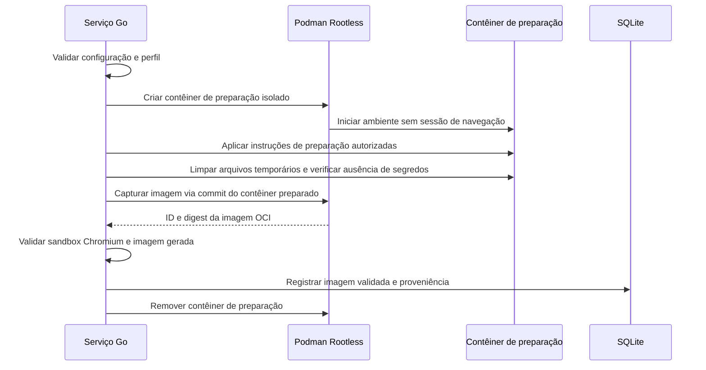

<!-- A-BIOMA-DOC-STANDARD -->
# FLUX-002 — Preparar e salvar uma imagem OCI reutilizável

**Estado:** Proposto.  
**Versão aprovada:** nenhuma.

## Objetivo

Iniciar um contêiner **de preparação** do Chromium, configurá-lo e, se habilitado no perfil do arquivo `config.yaml`, salvar seu filesystem preparado como nova imagem OCI para reutilização em futuras sessões.

## Pré-condições

- Arquivo de configuração validado e perfil com `source: prepare`.
- Imagem-base e insumos de preparação confiáveis; acesso ao Podman Rootless.
- Nenhuma navegação web de usuário, cookies, autenticação, downloads ou dados de sessão dentro do contêiner que será capturado.

## Sequência proposta

A captura pode utilizar `podman commit` de um contêiner iniciado: a documentação oficial informa que o Podman pausa por padrão um contêiner em execução durante o commit. **Volumes montados não entram na imagem por padrão**. Não confundir captura de imagem OCI com exportação de um contêiner em tar.

O `commit` pode armazenar segredos incorporados ao filesystem, inclusive em camadas: sanitização e prevenção de inclusão de segredos são requisitos, não garantia automática. O processo recomendado é preparar a imagem a partir de materiais controlados; não registrar dados privados no contêiner.

## Exceções

- Se `save_image.enabled` for falso, descartar o contêiner de preparação sem capturar imagem.
- Se o perfil não for confiável ou a validação de limpeza falhar, não promover a imagem; remover recursos temporários.
- Se `podman commit` falhar, manter erro e remover o contêiner de preparação de forma recuperável.
- Se a validação pós-captura falhar, marcar imagem como não utilizável e não atribuir o alias de uso padrão.
- A criação de imagem não pode substituir nem alterar imagem em uso por sessões abertas.

## Referências

- [Configuração](../referencia/REF-001-configuracao.md)
- [Imagens Chromium](../arquitetura/ARQ-003-imagens-chromium.md)
- [Persistência](../persistencia/PERS-001-sessoes-sqlite.md)
- [Segurança](../arquitetura/ARQ-002-seguranca.md)
- [Podman commit](https://docs.podman.io/en/latest/markdown/podman-commit.1.html)
- [Podman save](https://docs.podman.io/en/latest/markdown/podman-save.1.html)
