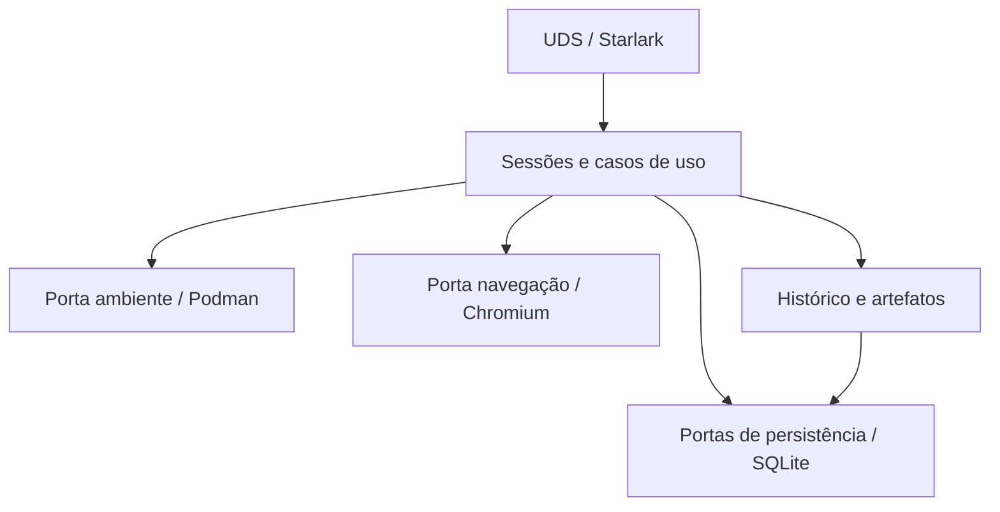

<!-- DOC-BACKLOG -->
<!-- DOC-MIL-0001 -->
<!-- DOC-STATUS REFINING -->

[Milestone MIL-0001](../../mil-0001.md).

# ARQ-005 — Arquitetura hexagonal e fronteiras dos módulos

**Estado:** desenho em refinamento. **Decisão de direção:** arquitetura hexagonal com módulos, conforme discussão aceita pelo usuário em 2026-11-16. Interfaces e detalhes abaixo são propostas desta revisão. Um serviço Go; módulos não implicam serviços separados.

## Responsabilidades e propriedade dos dados

| Módulo | Responsabilidade | Dados sob sua responsabilidade funcional |
| --- | --- | --- |
| sessoes | Casos de uso, autorização, coordenação e compensação | Sessão lógica, estado e execução |
| ambiente | Adaptador Podman: criar/remover contêiner e administrar imagem | IDs de contêiner, digest e resultado operacional |
| navegacao | Adaptador Chromium: páginas, elementos, cliques e downloads | Abas, referências DOM, resultado de interação e arquivo produzido |
| historico | Regras de passos, metadados sanitizados e catálogo | Sites acessados, botões acionados, falhas e localização dos arquivos |
| persistencia | Adaptador SQLite, transações e mapeamento físico | Schema físico, índices e operações de repositório |

Sessões e histórico definem as necessidades de armazenamento. SQLite implementa essas portas. Os documentos do adaptador ficam em persistencia para organizar a implementação; isso não autoriza o núcleo Go a importar o driver SQLite. Interfaces Go devem ser declaradas no núcleo consumidor ou em pacote de portas sem dependências técnicas. O ponto de composição injeta as implementações. Os contratos públicos documentados são a definição única das formas de dados.

Podman não gerencia o histórico de páginas ou cliques. Navegacao confirma os efeitos observados; sessoes coordena e historico registra. Logs técnicos de Podman/CDP usam o logger injetado e correlação; não são gravados por acesso SQL direto desses adaptadores. Caminhos internos e container_id nunca devem vazar automaticamente para a API externa.

## Dependências e chamadas permitidas

Esta revisão adota a exceção de interfaces públicas discutida e aceita para o projeto: módulos podem chamar somente as portas explicitamente listadas. A regra genérica 2.0 que proíbe toda referência entre módulos foi ajustada localmente; o plugin não foi alterado. O compartilhamento global fica restrito a tipos/convenções, sem copiar contratos nem esconder implementações em global.

| Chamador | Porta permitida | Motivo |
| --- | --- | --- |
| Entrada UDS / executor Starlark | Casos de uso de sessoes | Autorização, limites e correlação antes de efeito |
| sessoes | ambiente: criar/remover | Provisionamento e compensação |
| sessoes | navegacao: navegar/clicar/baixar | Operações do navegador |
| sessoes | historico: registrar passo/catalogar | Auditoria funcional e arquivos |
| sessoes | persistencia: salvar sessão | Porta de repositório da sessão |
| historico | persistencia: gravar passo/salvar artefato | Portas dos repositórios de histórico |
| ambiente | Podman e logger injetados | Integração de infraestrutura |
| navegacao | Chromium, armazenamento privado e logger injetados | Integração de infraestrutura |
| persistencia | SQLite | Acesso parametrizado ao banco |
| global | Apenas global | Tipos compartilhados sem lógica de módulos |

Qualquer chamada adicional exige atualizar esta matriz e seus contratos. Nenhum módulo consome tabelas, estruturas privadas ou funções internas de outro. Esta matriz representa invocações em tempo de execução; dependências de código obedecem à inversão por interfaces.

## Contratos por nível

| Nível | Dados permitidos | Dados que ficam internos |
| --- | --- | --- |
| Entrada | execution_id, session_id e ação autorizada | Contexto de permissão é obtido pelo servidor |
| Sessões → ambiente | session_id, perfil autorizado e digest | Socket Podman, montagem e argumentos de processo |
| Sessões → navegação | session_id, tab_id, URL ou referência DOM, timeout | Conexão CDP e container_id resolvidos pelo serviço |
| Sessões → histórico | step_id, operação, status e alvo sanitizado | Tokens, cookies e valores de formulário |
| Produtor → catálogo | artifact_id, storage_key relativa, tipo, tamanho e checksum | Caminho absoluto e bytes |
| Núcleo → persistência | Objetos tipados | SQL, conexão e transação |

Contextos de sessão, aba e permissão são resolvidos no host e injetados. Não criar novo formato de autenticação presumindo que um ID seja autorização. A porta externa UDS/MessagePack e o canal CDP concreto ainda precisam de refinamento.

## Fluxos concretos desta rodada

- Provisionar: validar entrada → criar contêiner → persistir vínculo em estado starting → retornar. Se persistência falha, remover o contêiner; se remoção falha, devolver compensation_failed e exigir reconciliação por rótulo de sessão.
- Navegar com histórico: validar contexto → navegador → montar metadados sanitizados → registrar passo → retornar. Se o histórico falha após navegação, retornar navigation_completed_audit_failed; não repetir automaticamente a navegação.
- Registrar passo: validar metadados → repositório SQLite → retornar sequência. step_id identifica uma ação, enquanto PAS identifica uma regra documental.
- Catalogar: validar metadados confirmados do arquivo → repositório SQLite → confirmar registro. Falha de catálogo não significa que o arquivo deixou de existir; reconciliação deve localizar órfãos.
- Clicar/baixar: portas técnicas próprias com campos e erros; o supervisor deve envolver cada ação pelo mesmo ciclo de histórico. A composição completa desses dois casos de uso e as operações restantes da API Starlark permanecem no backlog, sem serem apresentadas como implementadas.

## Persistência e artefatos

SQLite guarda metadados, não HTML, PDF ou screenshots. A área privada por sessão mantém os arquivos. Encerramento do contêiner não expurga automaticamente arquivos ainda retidos. Retenção, events.jsonl e projeção result.json conservam os requisitos existentes; atomicidade entre banco, eventos e projeção ainda precisa de fluxo específico.

O catálogo de passos registra alvo sanitizado para navegação e referência de botão/elemento para clique. O catálogo de artefatos guarda storage_key relativa. Correlação entre step e artifact, horários de término e transições incrementais serão completadas no contrato consolidado; os contratos desta rodada são recortes de operações, não substitutos silenciosos de todo o resultado v1.

## Evidências e pendências

Não existe implementação do serviço. O runner Starlark usa mocks. Esta revisão cria especificações e valida documentação; não comprova sandbox, protocolo CDP, persistência ou testes de integração.

Pendências: abertura do navegador e prontidão após provisionamento; emissão de IDs e contexto autorizado; cancelamento; captura HTML/screenshots; consultas paginadas e leitura por chunks; atualização incremental de passos; reconciliação após efeitos incertos; esquema de execuções/checkpoints/results. Preservar as especificações anteriores até a absorção desses pontos.

Referências conceituais: [Ports and Adapters — Alistair Cockburn](https://alistair.cockburn.us/hexagonal-architecture), [DDD — Martin Fowler](https://martinfowler.com/bliki/DomainDrivenDesign.html).
