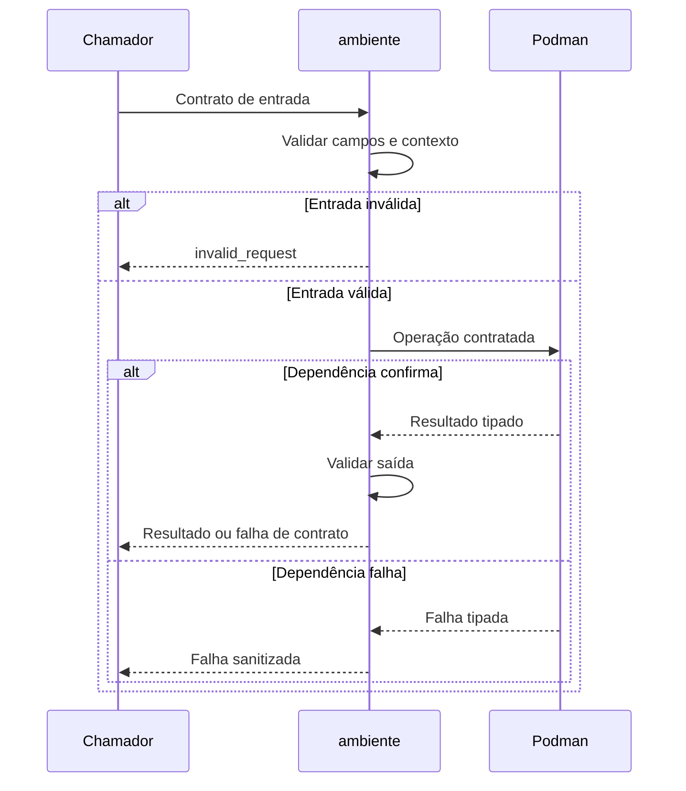

<!-- DOC-BACKLOG -->
<!-- DOC-MIL-0001 -->
<!-- DOC-STATUS REFINING -->

[Milestone MIL-0001](../../../../mil-0001.md).

# FLUX-0201 — Remover contêiner

**Estado:** em refinamento. **Versão aprovada:** nenhuma. **Módulo:** ambiente.

## Objetivo e pré-condições

Parar e remover somente o recurso rotulado com a sessão; ausência prévia é sucesso idempotente.

IDs não vazios; o container_id foi associado à session_id pelo serviço. Adaptador verifica rótulo real antes de remover.

Contratos: [entrada, saída e falha](../contratos/CONTR-103-remover-container.md). Assinatura pública, consumível somente conforme [matriz de dependências](../../../arquitetura/ARQ-005-arquitetura-hexagonal.md).

## Sequência



## Falhas, efeitos e telemetria

Não há retry automático. Cada chamada trata todas as falhas declaradas. Timeouts podem deixar efeito externo incerto; reconciliar antes de repetir. Correlacionar execução, session_id, step_id quando presente, fluxo, PAS e resultado; nunca registrar argumentos completos, tokens ou conteúdo de formulários. Logs técnicos do adaptador não substituem o histórico funcional.

## Critérios documentais

Cobrir sucesso, rejeição antes de efeito, falha da dependência e resposta incompatível. Não existem testes executados nem implementação destas portas. Neste fluxo, cobrir ausência prévia do contêiner, rótulo incompatível, timeout e resposta inválida. O adaptador Podman e seu mapeamento de falhas ainda precisam de implementação.


## Formato piloto

Este documento usa **Spec Rules 0.1.0**, proposta local da MIL-0001. A versão identifica o novo formato, não uma release do plugin nem compatibilidade com o schema SDD 2.0. As referências abreviadas são resolvidas pelo [catálogo do piloto](../../../referencia/REF-003-spec-rules.md). Estado documental: **em refinamento**; implementação não comprovada.
<a id="sdd"></a>
<a id="spec-rules"></a>
## Spec Rules

<!-- A-BIOMA-SPEC-RULES:0.1.0 -->

```yaml
FLUX-0201:
  formato: "a-bioma-spec-rules"
  versao: "0.1.0"
  modulo: "ambiente"
  estado: "em refinamento"
  implementacao: "nao implementado"
  objetivo: "Parar e remover somente o contêiner associado à sessão; ausência prévia é sucesso idempotente."
  acesso:
    tipo: "porta interna"
    contexto: "Injetado pelo serviço; IDs não concedem autorização."
    politica: "Apenas chamadas públicas permitidas pela ARQ-005."
  entrada:
    -
      nome: "solicitacao"
      doc: "@[ambiente](CONTR-103)"
  saida:
    -
      doc: "@[ambiente](CONTR-104)"
  fluxo:
    atores:
      -
        ator: "chamador"
        descricao: "Caso de uso autorizado que consome a porta."
      -
        ator: "ambiente"
        descricao: "Módulo que valida o pedido e adapta a operação."
      -
        ator: "podman"
        descricao: "Runtime rootless que administra o recurso."
    root:
      -
        id: "PAS-1006"
        acao: "validar"
        de: "ambiente"
        para: "ambiente"
        descricao: "Contrato de entrada"
        condicao:
          descricao: "session_id e container_id estão presentes, são textos não vazios e o vínculo foi autorizado pelo serviço; verificar tipos antes de interpretar valores."
          dados:
            -
              caminho: "entrada.solicitacao"
        valido: "continuar"
        invalido:
          nome: "Entrada inválida"
          acao: "falhar"
          para: "chamador"
          excecao: "EXC-0201"
          contrato: "@[ambiente](CONTR-105)"
          dados:
            literal:
              code: "invalid_request"
      -
        id: "PAS-1008"
        acao: "operar"
        de: "ambiente"
        para: "podman"
        descricao: "Parar e remover somente recurso com rótulo correspondente à sessão. O adaptador consulta o estado real e verifica o rótulo antes do efeito; ausência prévia retorna removed=true. Se houver mismatch, falhar sem remover."
        operacao: "podman.remover_container"
        entrada:
          -
            nome: "pedido"
            doc: "@[ambiente](CONTR-103)"
        argumentos:
          pedido:
            caminho: "entrada.solicitacao"
        saida:
          doc: "@[ambiente](CONTR-104)"
        guardar_em: "variaveis.resultado"
        excecoes:
          - "EXC-0201"
        erros:
          -
            excecao: "EXC-0201"
            guardar_em: "falhas.operacao"
            passos:
              -
                id: "PAS-1007"
                acao: "falhar"
                de: "ambiente"
                para: "chamador"
                descricao: "Propagar somente falha tipada e sanitizada do adaptador."
                excecao: "EXC-0201"
                contrato: "@[ambiente](CONTR-105)"
                dados:
                  caminho: "falhas.operacao"
        efeitos:
          - "Parar e remover o contêiner associado à sessão."
      -
        id: "PAS-1009"
        acao: "validar"
        de: "ambiente"
        para: "ambiente"
        descricao: "Contrato de saída"
        condicao:
          descricao: "Resultado tem session_id textual igual ao pedido e removed booleano igual a true."
          dados:
            -
              caminho: "variaveis.resultado"
            -
              caminho: "entrada.solicitacao"
        valido: "continuar"
        invalido:
          nome: "Resposta incompatível"
          acao: "falhar"
          para: "chamador"
          excecao: "EXC-0201"
          contrato: "@[ambiente](CONTR-105)"
          dados:
            literal:
              code: "invalid_dependency_result"
      -
        id: "PAS-1010"
        acao: "retornar"
        de: "ambiente"
        para: "chamador"
        descricao: "Entregar a única saída normal."
        contrato: "@[ambiente](CONTR-104)"
        valor:
          caminho: "variaveis.resultado"
  excecoes:
    -
      id: "EXC-0201"
      nome: "FalhaRemocao"
      condicao: "Entrada inválida, autorização negada, timeout, falha do runtime ou saída incompatível."
      contrato: "@[ambiente](CONTR-105)"
      recuperavel: false
      resultado: "Encerrar com falha sanitizada; preservar os efeitos já confirmados."
      codigos_fixos:
        - "invalid_request"
        - "invalid_dependency_result"
      codigos_runtime: "Mapeamento exato ainda pendente; o adaptador deve devolver código sanitizado no CONTR-105."
  efeitos:
    - "Parar e remover o contêiner da sessão."
  telemetria:
    correlacao:
      - "execucao"
      - "session_id"
      - "fluxo"
      - "passo"
      - "resultado"
    proibido:
      - "argumentos completos"
      - "tokens"
      - "cookies"
      - "conteudo de formularios"
    destino: "Logger injetado; logs técnicos não substituem histórico funcional."
  recuperacao:
    retry_automatico: false
    timeout: "Pode deixar efeito incerto; reconciliar o recurso antes de repetir."
  criterios:
    - "Sucesso retorna removed=true e o session_id recebido."
    - "Entrada inválida falha antes da chamada ao runtime."
    - "Ausência prévia retorna sucesso sem recriar recurso."
    - "Rótulo de outra sessão impede remoção."
    - "Falha da dependência é propagada por PAS-1007."
    - "Resposta incompatível falha em PAS-1009."
  pendencias:
    - "Definir mapeamento concreto de erros Podman."
    - "Implementar adaptador e testes; nenhuma execução comprovada."
```
