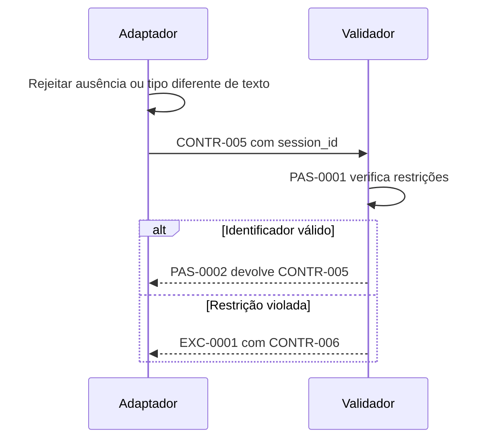

<!-- DOC-BACKLOG -->
<!-- DOC-MIL-0001 -->
<!-- DOC-STATUS REFINING -->
<!-- A-BIOMA-DOC-STANDARD -->
<!-- A-BIOMA-DOC-REVISADO -->
<!-- A-BIOMA-DOC-VERSION {"plugin":"a-bioma-doc-standard","version":"2.0.0"} -->

[Milestone MIL-0001](../../../../mil-0001.md). Proposta; publicação pendente.

# FLUX-0003 — Validar componente session_id

**Estado:** proposto; regra documental, sem implementação. **Versão aprovada:** nenhuma.

## Objetivo e limites

Formalizar a restrição lexical descrita em [CONTR-004](../contratos/CONTR-004-artefatos-resultados.md). Recebe texto já tipado; o adaptador externo deve rejeitar ausência ou tipo incompatível antes de invocar este fluxo. Não valida posse, existência, symlinks, resolução de caminho ou cotas. A interpretação de caracteres de controle como Unicode Cc é proposta nesta revisão, ainda sujeita a refinamento.

CONTR-005 e CONTR-006 têm definição canônica no YAML abaixo. A referência declarativa do campo a este fluxo não dispara nova chamada. Falha monta o código fixo; sucesso preserva o texto.

## Sequência



## Aceite e telemetria

Casos propostos: aceitar `sess_exemplo`; rejeitar texto vazio, `/`, `..` e controle; rejeitar tipo numérico no adaptador. Não existe teste desta regra. Telemetria futura correlaciona fluxo, passo e execução sem registrar o identificador rejeitado.

<a id="sdd"></a>
## SDD — Spec-Driven Development

<!-- A-BIOMA-SPEC:2.0 -->

```yaml
especificacao:
  formato: a-bioma-comportamento
  versao: '2.0'
  documento: FLUX-0003
  modulo: automacao
  estado: proposto
  tipos:
  - id: TIP-0001
    nome: Texto
    base: texto
  contratos:
  - id: CONTR-005
    nome: IdentificadorSessao
    descricao: Entrada e saída lexical; não concede autorização. Adaptador rejeita
      tipo externo diferente de texto antes da chamada.
    campos:
    - id: CMP-0001
      nome: session_id
      tipo:
        id: TIP-0001
      obrigatorio: true
      regras:
      - id: FLUX-0003
  - id: CONTR-006
    nome: FalhaIdentificador
    campos:
    - id: CMP-0002
      nome: code
      tipo:
        id: TIP-0001
      obrigatorio: true
      regras:
      - id: FLUX-0003
  excecoes:
  - id: EXC-0001
    nome: SessionIdInvalido
    condicao: session_id vazio ou com /, .. ou caracteres de controle
    resultado: Rejeitar identificador sem produzir caminho ou efeito externo
    recuperavel: false
    contrato:
      id: CONTR-006
  fluxos:
  - id: FLUX-0003
    nome: validar_session_id
    categoria: validacao
    entradas:
    - nome: solicitacao
      contrato:
        id: CONTR-005
    saida:
      id: CONTR-005
    excecoes:
    - id: EXC-0001
    efeitos: []
    passos:
    - id: PAS-0001
      acao: validar
      descricao: Aplicar explicitamente a regra de CMP-0001; em falha montar CMP-0002
        com código fixo, sem repetir entrada sensível.
      condicao:
        descricao: Texto não vazio, sem barra /, sem sequência .. e sem caracteres
          Unicode da categoria Cc. Não normalizar ou alterar o identificador.
        dados:
        - caminho: entradas.solicitacao.session_id
      falha:
        id: EXC-0001
      dados_falha:
        literal:
          code: invalid_request
    - id: PAS-0002
      acao: retornar
      descricao: Devolver o contrato de entrada validado sem alteração.
      valor:
        caminho: entradas.solicitacao
```
