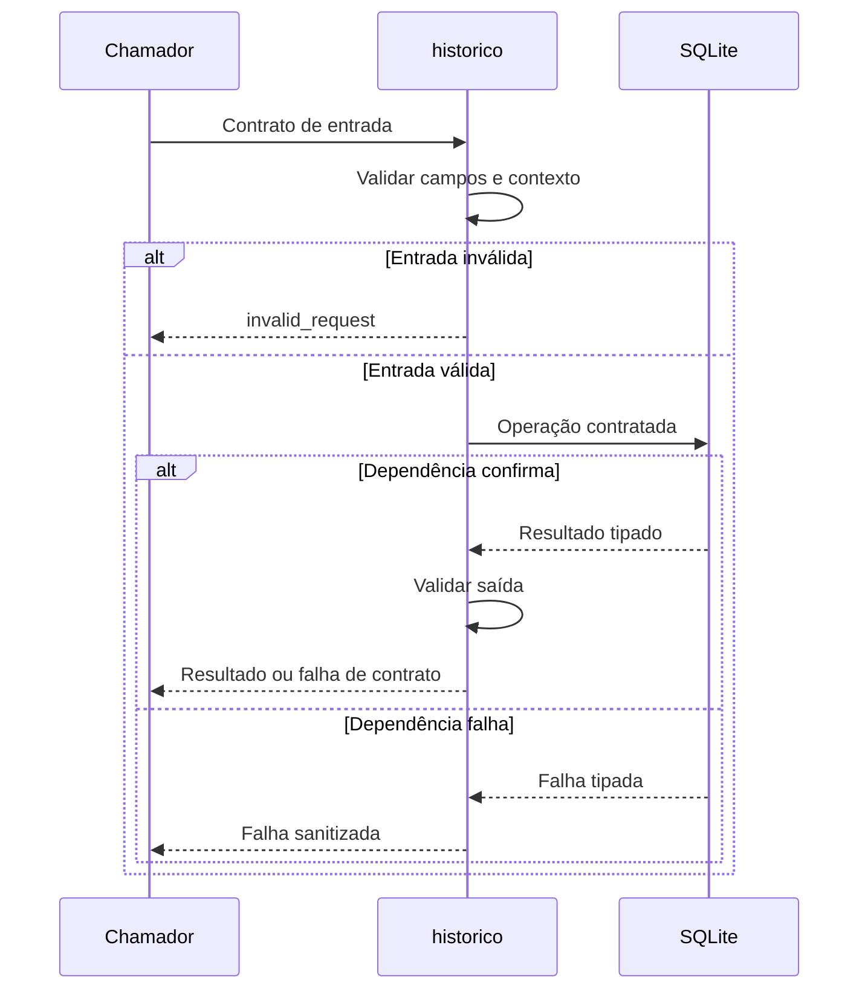

<!-- DOC-BACKLOG -->
<!-- DOC-MIL-0001 -->
<!-- DOC-STATUS REFINING -->

[Milestone MIL-0001](../../../../mil-0001.md).

# FLUX-0400 — Registrar passo de navegação

**Estado:** proposto. **Versão aprovada:** nenhuma. **Módulo:** historico.

## Objetivo e pré-condições

Sanitizar metadados e solicitar persistência idempotente de um passo.

IDs opacos não vazios; operation pertence ao catálogo de operações; status é completed, failed ou cancelled; target não contém credenciais, fragmentos, parâmetros secretos nem valores de formulário.

Contratos: [entrada, saída e falha](../contratos/CONTR-109-registrar-passo.md). Assinatura pública, consumível somente conforme [matriz de dependências](../../../arquitetura/ARQ-005-arquitetura-hexagonal.md).

## Sequência



## Falhas, efeitos e telemetria

Não há retry automático. Cada chamada trata todas as falhas declaradas. Timeouts podem deixar efeito externo incerto; reconciliar antes de repetir. Correlacionar execução, session_id, step_id quando presente, fluxo, PAS e resultado; nunca registrar argumentos completos, tokens ou conteúdo de formulários. Logs técnicos do adaptador não substituem o histórico funcional.

## Critérios documentais

Cobrir sucesso, rejeição antes de efeito, falha da dependência e resposta incompatível. Não existem testes executados nem implementação destas portas. Em provisionamento, testar falha de persistência e falha da compensação; na navegação, testar histórico indisponível após efeito confirmado. As portas de CDP, autorização e migração SQL ainda precisam de implementação.


<a id="sdd"></a>
## SDD — Spec-Driven Development

<!-- A-BIOMA-SPEC:2.0 -->

```yaml
especificacao:
  formato: a-bioma-comportamento
  versao: '2.0'
  documento: FLUX-0400
  modulo: historico
  estado: proposto
  tipos: []
  contratos:
  - id: CONTR-109
    documento: ../contratos/CONTR-109-registrar-passo.md#sdd
  - id: CONTR-110
    documento: ../contratos/CONTR-109-registrar-passo.md#sdd
  - id: CONTR-111
    documento: ../contratos/CONTR-109-registrar-passo.md#sdd
  excecoes:
  - id: EXC-0400
    nome: Falha0400
    condicao: Validação, autorização, timeout ou falha da dependência desta porta.
    resultado: Encerrar a operação com código sanitizado, preservando efeitos já confirmados.
    recuperavel: false
    contrato:
      id: CONTR-111
      documento: ../contratos/CONTR-109-registrar-passo.md#sdd
  fluxos:
  - id: FLUX-0400
    nome: Registrar passo de navegação
    categoria: metodo
    entradas:
    - nome: solicitacao
      contrato:
        id: CONTR-109
        documento: ../contratos/CONTR-109-registrar-passo.md#sdd
    saida:
      id: CONTR-110
      documento: ../contratos/CONTR-109-registrar-passo.md#sdd
    excecoes:
    - id: EXC-0400
    efeitos:
    - Persistir metadados sanitizados do passo
    passos:
    - id: PAS-1016
      acao: validar
      descricao: Validar tipos e regras de entrada antes de acessar dependências.
      condicao:
        descricao: IDs opacos não vazios; operation pertence ao catálogo de operações;
          status é completed, failed ou cancelled; target não contém credenciais,
          fragmentos, parâmetros secretos nem valores de formulário. Todos os campos
          presentes e com os tipos declarados; rejeitar antes de interpretar valores.
        dados:
        - caminho: entradas.solicitacao
      falha:
        id: EXC-0400
      dados_falha:
        literal:
          code: invalid_request
    - id: PAS-1017
      acao: atribuir
      descricao: Inicializar objeto local.
      destino: variaveis.registro
      valor:
        literal: {}
    - id: PAS-1018
      acao: atribuir
      descricao: Copiar campo tipado session_id.
      destino: variaveis.registro.session_id
      valor:
        caminho: entradas.solicitacao.session_id
    - id: PAS-1019
      acao: atribuir
      descricao: Copiar campo tipado step_id.
      destino: variaveis.registro.step_id
      valor:
        caminho: entradas.solicitacao.step_id
    - id: PAS-1020
      acao: atribuir
      descricao: Copiar campo tipado operation.
      destino: variaveis.registro.operation
      valor:
        caminho: entradas.solicitacao.operation
    - id: PAS-1021
      acao: atribuir
      descricao: Copiar campo tipado target.
      destino: variaveis.registro.target
      valor:
        caminho: entradas.solicitacao.target
    - id: PAS-1022
      acao: atribuir
      descricao: Copiar campo tipado status.
      destino: variaveis.registro.status
      valor:
        caminho: entradas.solicitacao.status
    - id: PAS-1024
      acao: chamar
      descricao: Chamar porta pública FLUX-0501.
      fluxo:
        id: FLUX-0501
        documento: ../../persistencia/fluxos/FLUX-0501-gravar-passo.md#sdd
      argumentos:
      - nome: solicitacao
        valor:
          caminho: variaveis.registro
      guardar_em: variaveis.resultado
      erros:
      - origem:
          id: EXC-0501
          documento: ../../persistencia/fluxos/FLUX-0501-gravar-passo.md#sdd
        guardar_em: falhas.dependencia
        passos:
        - id: PAS-1023
          acao: falhar
          descricao: Encerrar com código sanitizado; não repetir efeitos.
          excecao:
            id: EXC-0400
          dados:
            literal:
              code: dependency_failure
    - id: PAS-1025
      acao: validar
      descricao: Verificar contrato de saída antes de retornar.
      condicao:
        descricao: Resultado contém todos os campos obrigatórios nos tipos declarados;
          session_id corresponde à entrada; IDs de recurso não vazios quando presentes;
          revision e sequence não negativos; saved/removed verdadeiros quando presentes.
        dados:
        - caminho: variaveis.resultado
        - caminho: entradas.solicitacao
      falha:
        id: EXC-0400
      dados_falha:
        literal:
          code: invalid_dependency_result
    - id: PAS-1026
      acao: retornar
      descricao: Entregar a única saída normal desta porta.
      valor:
        caminho: variaveis.resultado
```
