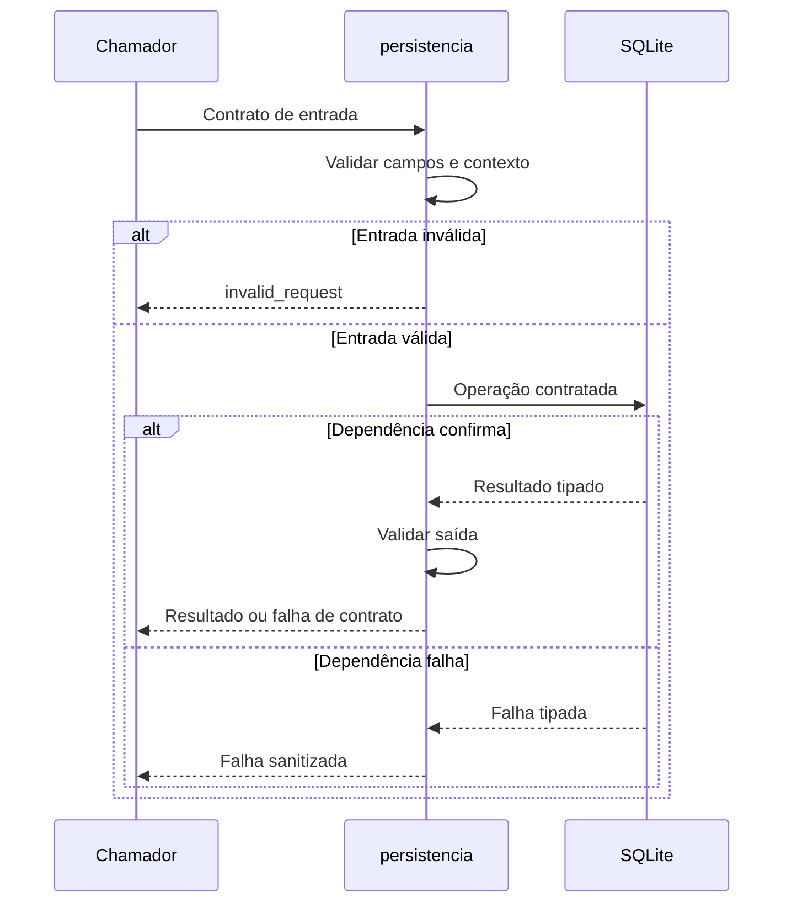

<!-- DOC-BACKLOG -->
<!-- DOC-MIL-0001 -->
<!-- DOC-STATUS REFINING -->

[Milestone MIL-0001](../../../../mil-0001.md).

# FLUX-0501 — Persistir passo operacional

**Estado:** proposto. **Versão aprovada:** nenhuma. **Módulo:** persistencia.

## Objetivo e pré-condições

Transação curta registra step_id único e aloca sequence monotônica por sessão; repetir mesmo step_id e dados devolve a sequência existente; conflito de dados falha.

Sessão existe; step_id não vazio; operation e status válidos; target já sanitizado. Chave única (session_id, step_id) e (session_id, sequence) propostas; sequência alocada atomicamente.

Contratos: [entrada, saída e falha](../contratos/CONTR-115-gravar-passo.md). Assinatura pública, consumível somente conforme [matriz de dependências](../../../arquitetura/ARQ-005-arquitetura-hexagonal.md).

## Sequência



## Falhas, efeitos e telemetria

Não há retry automático. Cada chamada trata todas as falhas declaradas. Timeouts podem deixar efeito externo incerto; reconciliar antes de repetir. Correlacionar execução, session_id, step_id quando presente, fluxo, PAS e resultado; nunca registrar argumentos completos, tokens ou conteúdo de formulários. Logs técnicos do adaptador não substituem o histórico funcional.

## Critérios documentais

Cobrir sucesso, rejeição antes de efeito, falha da dependência e resposta incompatível. Não existem testes executados nem implementação destas portas. Em provisionamento, testar falha de persistência e falha da compensação; na navegação, testar histórico indisponível após efeito confirmado. As portas de CDP, autorização e migração SQL ainda precisam de implementação.


<a id="sdd"></a>
## SDD — Spec-Driven Development

<!-- A-BIOMA-SPEC:2.0 -->

```yaml
especificacao:
  formato: a-bioma-comportamento
  versao: '2.0'
  documento: FLUX-0501
  modulo: persistencia
  estado: proposto
  tipos: []
  contratos:
  - id: CONTR-115
    documento: ../contratos/CONTR-115-gravar-passo.md#sdd
  - id: CONTR-116
    documento: ../contratos/CONTR-115-gravar-passo.md#sdd
  - id: CONTR-117
    documento: ../contratos/CONTR-115-gravar-passo.md#sdd
  excecoes:
  - id: EXC-0501
    nome: Falha0501
    condicao: Validação, autorização, timeout ou falha da dependência desta porta.
    resultado: Encerrar a operação com código sanitizado, preservando efeitos já confirmados.
    recuperavel: false
    contrato:
      id: CONTR-117
      documento: ../contratos/CONTR-115-gravar-passo.md#sdd
  fluxos:
  - id: FLUX-0501
    nome: Persistir passo operacional
    categoria: metodo
    entradas:
    - nome: solicitacao
      contrato:
        id: CONTR-115
        documento: ../contratos/CONTR-115-gravar-passo.md#sdd
    saida:
      id: CONTR-116
      documento: ../contratos/CONTR-115-gravar-passo.md#sdd
    excecoes:
    - id: EXC-0501
    efeitos: &id001
    - Persistir session_steps
    passos:
    - id: PAS-1032
      acao: validar
      descricao: Validar tipos e regras de entrada antes de acessar dependências.
      condicao:
        descricao: Sessão existe; step_id não vazio; operation e status válidos; target
          já sanitizado. Chave única (session_id, step_id) e (session_id, sequence)
          propostas; sequência alocada atomicamente. Todos os campos presentes e com
          os tipos declarados; rejeitar antes de interpretar valores.
        dados:
        - caminho: entradas.solicitacao
      falha:
        id: EXC-0501
      dados_falha:
        literal:
          code: invalid_request
    - id: PAS-1034
      acao: operar
      descricao: Transação curta registra step_id único e aloca sequence monotônica
        por sessão; repetir mesmo step_id e dados devolve a sequência existente; conflito
        de dados falha. O adaptador implementa o protocolo e confirma o efeito; invariantes
        transacionais estão descritas nesta porta.
      operacao: sqlite.gravar_passo
      entradas:
      - nome: pedido
        contrato:
          id: CONTR-115
          documento: ../contratos/CONTR-115-gravar-passo.md#sdd
      argumentos:
      - nome: pedido
        valor:
          caminho: entradas.solicitacao
      saida:
        id: CONTR-116
        documento: ../contratos/CONTR-115-gravar-passo.md#sdd
      guardar_em: variaveis.resultado
      excecoes:
      - id: EXC-0501
      erros:
      - origem:
          id: EXC-0501
        guardar_em: falhas.operacao
        passos:
        - id: PAS-1033
          acao: falhar
          descricao: Propagar somente falha tipada e sanitizada do adaptador.
          excecao:
            id: EXC-0501
          dados:
            caminho: falhas.operacao
      efeitos: *id001
    - id: PAS-1035
      acao: validar
      descricao: Verificar contrato de saída antes de retornar.
      condicao:
        descricao: Resultado contém todos os campos obrigatórios nos tipos declarados;
          session_id corresponde à entrada; IDs de recurso não vazios quando presentes;
          revision e sequence não negativos; saved/removed verdadeiros quando presentes.
        dados:
        - caminho: variaveis.resultado
        - caminho: entradas.solicitacao
      falha:
        id: EXC-0501
      dados_falha:
        literal:
          code: invalid_dependency_result
    - id: PAS-1036
      acao: retornar
      descricao: Entregar a única saída normal desta porta.
      valor:
        caminho: variaveis.resultado
```
