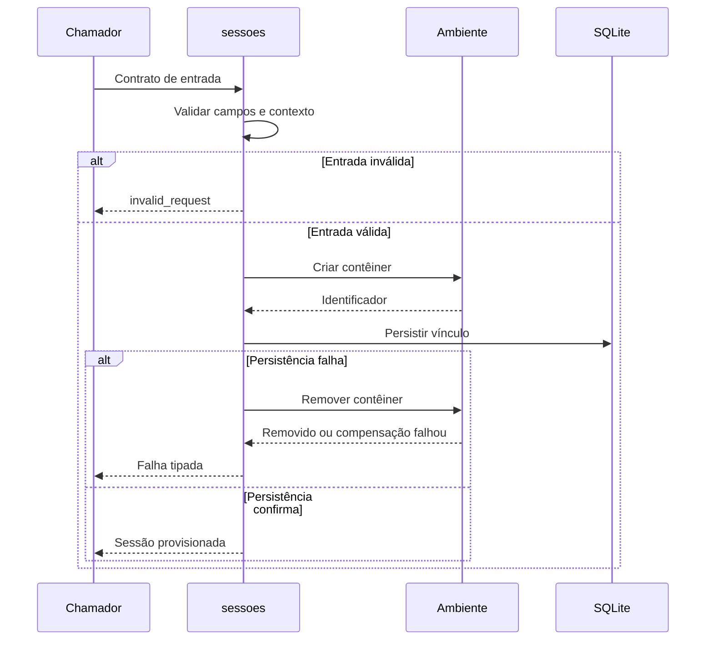

<!-- DOC-BACKLOG -->
<!-- DOC-MIL-0001 -->
<!-- DOC-STATUS REFINING -->

[Milestone MIL-0001](../../../../mil-0001.md).

# FLUX-0100 — Provisionar sessão

**Estado:** proposto. **Versão aprovada:** nenhuma. **Módulo:** sessoes.

## Objetivo e pré-condições

Criar contêiner e persistir associação; compensar criação quando persistência falhar.

Entrada vem de caso de uso autenticado; session_id foi emitido pelo serviço, é único, opaco e válido; perfil e digest foram autorizados. Operação ainda não declara navegador pronto.

Contratos: [entrada, saída e falha](../contratos/CONTR-118-provisionar.md). Assinatura pública, consumível somente conforme [matriz de dependências](../../../arquitetura/ARQ-005-arquitetura-hexagonal.md).

## Sequência



## Falhas, efeitos e telemetria

Não há retry automático. Cada chamada trata todas as falhas declaradas. Timeouts podem deixar efeito externo incerto; reconciliar antes de repetir. Correlacionar execução, session_id, step_id quando presente, fluxo, PAS e resultado; nunca registrar argumentos completos, tokens ou conteúdo de formulários. Logs técnicos do adaptador não substituem o histórico funcional.

## Critérios documentais

Cobrir sucesso, rejeição antes de efeito, falha da dependência e resposta incompatível. Não existem testes executados nem implementação destas portas. Em provisionamento, testar falha de persistência e falha da compensação; na navegação, testar histórico indisponível após efeito confirmado. As portas de CDP, autorização e migração SQL ainda precisam de implementação.


<a id="sdd"></a>
## SDD — Spec-Driven Development

<!-- A-BIOMA-SPEC:2.0 -->

```yaml
especificacao:
  formato: a-bioma-comportamento
  versao: '2.0'
  documento: FLUX-0100
  modulo: sessoes
  estado: proposto
  tipos: []
  contratos:
  - id: CONTR-118
    documento: ../contratos/CONTR-118-provisionar.md#sdd
  - id: CONTR-119
    documento: ../contratos/CONTR-118-provisionar.md#sdd
  - id: CONTR-120
    documento: ../contratos/CONTR-118-provisionar.md#sdd
  excecoes:
  - id: EXC-0100
    nome: Falha0100
    condicao: Validação, autorização, timeout ou falha da dependência desta porta.
    resultado: Encerrar a operação com código sanitizado, preservando efeitos já confirmados.
    recuperavel: false
    contrato:
      id: CONTR-120
      documento: ../contratos/CONTR-118-provisionar.md#sdd
  fluxos:
  - id: FLUX-0100
    nome: Provisionar sessão
    categoria: processo
    entradas:
    - nome: solicitacao
      contrato:
        id: CONTR-118
        documento: ../contratos/CONTR-118-provisionar.md#sdd
    saida:
      id: CONTR-119
      documento: ../contratos/CONTR-118-provisionar.md#sdd
    excecoes:
    - id: EXC-0100
    efeitos:
    - Criar contêiner
    - Persistir vínculo da sessão
    - Remover contêiner em compensação
    passos:
    - id: PAS-1037
      acao: validar
      descricao: Validar tipos e regras de entrada antes de acessar dependências.
      condicao:
        descricao: Entrada vem de caso de uso autenticado; session_id foi emitido
          pelo serviço, é único, opaco e válido; perfil e digest foram autorizados.
          Operação ainda não declara navegador pronto. Todos os campos presentes e
          com os tipos declarados; rejeitar antes de interpretar valores.
        dados:
        - caminho: entradas.solicitacao
      falha:
        id: EXC-0100
      dados_falha:
        literal:
          code: invalid_request
    - id: PAS-1038
      acao: atribuir
      descricao: Inicializar objeto local.
      destino: variaveis.criacao
      valor:
        literal: {}
    - id: PAS-1039
      acao: atribuir
      descricao: Copiar campo tipado session_id.
      destino: variaveis.criacao.session_id
      valor:
        caminho: entradas.solicitacao.session_id
    - id: PAS-1040
      acao: atribuir
      descricao: Copiar campo tipado image_digest.
      destino: variaveis.criacao.image_digest
      valor:
        caminho: entradas.solicitacao.image_digest
    - id: PAS-1041
      acao: atribuir
      descricao: Copiar campo tipado profile_name.
      destino: variaveis.criacao.profile_name
      valor:
        caminho: entradas.solicitacao.profile_name
    - id: PAS-1043
      acao: chamar
      descricao: Chamar porta pública FLUX-0200.
      fluxo:
        id: FLUX-0200
        documento: ../../ambiente/fluxos/FLUX-0200-criar-container.md#sdd
      argumentos:
      - nome: solicitacao
        valor:
          caminho: variaveis.criacao
      guardar_em: variaveis.container
      erros:
      - origem:
          id: EXC-0200
          documento: ../../ambiente/fluxos/FLUX-0200-criar-container.md#sdd
        guardar_em: falhas.dependencia
        passos:
        - id: PAS-1042
          acao: falhar
          descricao: Encerrar com código sanitizado; não repetir efeitos.
          excecao:
            id: EXC-0100
          dados:
            literal:
              code: dependency_failure
    - id: PAS-1044
      acao: atribuir
      descricao: Inicializar objeto local.
      destino: variaveis.salvar
      valor:
        literal: {}
    - id: PAS-1045
      acao: atribuir
      descricao: Copiar campo tipado session_id.
      destino: variaveis.salvar.session_id
      valor:
        caminho: variaveis.container.session_id
    - id: PAS-1046
      acao: atribuir
      descricao: Copiar campo tipado container_id.
      destino: variaveis.salvar.container_id
      valor:
        caminho: variaveis.container.container_id
    - id: PAS-1047
      acao: atribuir
      descricao: Associar digest autorizado.
      destino: variaveis.salvar.image_digest
      valor:
        caminho: entradas.solicitacao.image_digest
    - id: PAS-1054
      acao: chamar
      descricao: Chamar porta pública FLUX-0500.
      fluxo:
        id: FLUX-0500
        documento: ../../persistencia/fluxos/FLUX-0500-salvar-sessao.md#sdd
      argumentos:
      - nome: solicitacao
        valor:
          caminho: variaveis.salvar
      guardar_em: variaveis.persistido
      erros:
      - origem:
          id: EXC-0500
          documento: ../../persistencia/fluxos/FLUX-0500-salvar-sessao.md#sdd
        guardar_em: falhas.dependencia
        passos:
        - id: PAS-1048
          acao: atribuir
          descricao: Inicializar objeto local.
          destino: variaveis.remover
          valor:
            literal: {}
        - id: PAS-1049
          acao: atribuir
          descricao: Copiar campo tipado session_id.
          destino: variaveis.remover.session_id
          valor:
            caminho: variaveis.container.session_id
        - id: PAS-1050
          acao: atribuir
          descricao: Copiar campo tipado container_id.
          destino: variaveis.remover.container_id
          valor:
            caminho: variaveis.container.container_id
        - id: PAS-1052
          acao: chamar
          descricao: Chamar porta pública FLUX-0201.
          fluxo:
            id: FLUX-0201
            documento: ../../ambiente/fluxos/FLUX-0201-remover-container.md#sdd
          argumentos:
          - nome: solicitacao
            valor:
              caminho: variaveis.remover
          guardar_em: variaveis.remocao
          erros:
          - origem:
              id: EXC-0201
              documento: ../../ambiente/fluxos/FLUX-0201-remover-container.md#sdd
            guardar_em: falhas.dependencia
            passos:
            - id: PAS-1051
              acao: falhar
              descricao: Encerrar com código sanitizado; não repetir efeitos.
              excecao:
                id: EXC-0100
              dados:
                literal:
                  code: compensation_failed
        - id: PAS-1053
          acao: falhar
          descricao: Encerrar com código sanitizado; não repetir efeitos.
          excecao:
            id: EXC-0100
          dados:
            literal:
              code: persistence_failed_container_removed
    - id: PAS-1055
      acao: atribuir
      descricao: Preparar retorno; estado permanece starting.
      destino: variaveis.resultado
      valor:
        caminho: variaveis.container
    - id: PAS-1056
      acao: validar
      descricao: Verificar contrato de saída antes de retornar.
      condicao:
        descricao: Resultado contém todos os campos obrigatórios nos tipos declarados;
          session_id corresponde à entrada; IDs de recurso não vazios quando presentes;
          revision e sequence não negativos; saved/removed verdadeiros quando presentes.
        dados:
        - caminho: variaveis.resultado
        - caminho: entradas.solicitacao
      falha:
        id: EXC-0100
      dados_falha:
        literal:
          code: invalid_dependency_result
    - id: PAS-1057
      acao: retornar
      descricao: Entregar a única saída normal desta porta.
      valor:
        caminho: variaveis.resultado
```
