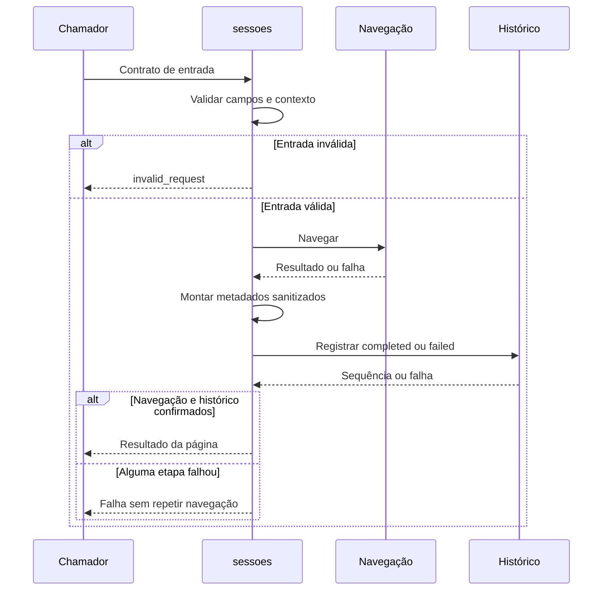

<!-- DOC-BACKLOG -->
<!-- DOC-MIL-0001 -->
<!-- DOC-STATUS REFINING -->

[Milestone MIL-0001](../../../../mil-0001.md).

# FLUX-0101 — Navegar e registrar resultado

**Estado:** proposto. **Versão aprovada:** nenhuma. **Módulo:** sessoes.

## Objetivo e pré-condições

Coordenar navegação e gravação do passo; falha no histórico não repete a ação no navegador.

Sessão pronta e autorizada no contexto do chamador; step_id emitido pelo serviço e único; URL, aba e timeout dentro da política. Não aceitar contexto de autorização fornecido pelo script.

Contratos: [entrada, saída e falha](../contratos/CONTR-121-navegar-com-historico.md). Assinatura pública, consumível somente conforme [matriz de dependências](../../../arquitetura/ARQ-005-arquitetura-hexagonal.md).

## Sequência



## Falhas, efeitos e telemetria

Não há retry automático. Cada chamada trata todas as falhas declaradas. Timeouts podem deixar efeito externo incerto; reconciliar antes de repetir. Correlacionar execução, session_id, step_id quando presente, fluxo, PAS e resultado; nunca registrar argumentos completos, tokens ou conteúdo de formulários. Logs técnicos do adaptador não substituem o histórico funcional.

## Critérios documentais

Cobrir sucesso, rejeição antes de efeito, falha da dependência e resposta incompatível. Não existem testes executados nem implementação destas portas. Em provisionamento, testar falha de persistência e falha da compensação; na navegação, testar histórico indisponível após efeito confirmado. As portas de CDP, autorização e migração SQL ainda precisam de implementação.


<a id="sdd"></a>
## SDD — Spec-Driven Development

<!-- A-BIOMA-SPEC:2.0 -->

```yaml
especificacao:
  formato: a-bioma-comportamento
  versao: '2.0'
  documento: FLUX-0101
  modulo: sessoes
  estado: proposto
  tipos: []
  contratos:
  - id: CONTR-121
    documento: ../contratos/CONTR-121-navegar-com-historico.md#sdd
  - id: CONTR-122
    documento: ../contratos/CONTR-121-navegar-com-historico.md#sdd
  - id: CONTR-123
    documento: ../contratos/CONTR-121-navegar-com-historico.md#sdd
  excecoes:
  - id: EXC-0101
    nome: Falha0101
    condicao: Validação, autorização, timeout ou falha da dependência desta porta.
    resultado: Encerrar a operação com código sanitizado, preservando efeitos já confirmados.
    recuperavel: false
    contrato:
      id: CONTR-123
      documento: ../contratos/CONTR-121-navegar-com-historico.md#sdd
  fluxos:
  - id: FLUX-0101
    nome: Navegar e registrar resultado
    categoria: processo
    entradas:
    - nome: solicitacao
      contrato:
        id: CONTR-121
        documento: ../contratos/CONTR-121-navegar-com-historico.md#sdd
    saida:
      id: CONTR-122
      documento: ../contratos/CONTR-121-navegar-com-historico.md#sdd
    excecoes:
    - id: EXC-0101
    efeitos:
    - Navegar na aba
    - Registrar metadados do resultado
    passos:
    - id: PAS-1058
      acao: validar
      descricao: Validar tipos e regras de entrada antes de acessar dependências.
      condicao:
        descricao: Sessão pronta e autorizada no contexto do chamador; step_id emitido
          pelo serviço e único; URL, aba e timeout dentro da política. Não aceitar
          contexto de autorização fornecido pelo script. Todos os campos presentes
          e com os tipos declarados; rejeitar antes de interpretar valores.
        dados:
        - caminho: entradas.solicitacao
      falha:
        id: EXC-0101
      dados_falha:
        literal:
          code: invalid_request
    - id: PAS-1059
      acao: atribuir
      descricao: Inicializar objeto local.
      destino: variaveis.navegacao
      valor:
        literal: {}
    - id: PAS-1060
      acao: atribuir
      descricao: Copiar campo tipado session_id.
      destino: variaveis.navegacao.session_id
      valor:
        caminho: entradas.solicitacao.session_id
    - id: PAS-1061
      acao: atribuir
      descricao: Copiar campo tipado tab_id.
      destino: variaveis.navegacao.tab_id
      valor:
        caminho: entradas.solicitacao.tab_id
    - id: PAS-1062
      acao: atribuir
      descricao: Copiar campo tipado url.
      destino: variaveis.navegacao.url
      valor:
        caminho: entradas.solicitacao.url
    - id: PAS-1063
      acao: atribuir
      descricao: Copiar campo tipado timeout_ms.
      destino: variaveis.navegacao.timeout_ms
      valor:
        caminho: entradas.solicitacao.timeout_ms
    - id: PAS-1073
      acao: chamar
      descricao: Chamar porta pública FLUX-0300.
      fluxo:
        id: FLUX-0300
        documento: ../../navegacao/fluxos/FLUX-0300-navegar.md#sdd
      argumentos:
      - nome: solicitacao
        valor:
          caminho: variaveis.navegacao
      guardar_em: variaveis.resultado
      erros:
      - origem:
          id: EXC-0300
          documento: ../../navegacao/fluxos/FLUX-0300-navegar.md#sdd
        guardar_em: falhas.dependencia
        passos:
        - id: PAS-1064
          acao: atribuir
          descricao: Inicializar objeto local.
          destino: variaveis.falha_passo
          valor:
            literal: {}
        - id: PAS-1065
          acao: atribuir
          descricao: Copiar campo tipado session_id.
          destino: variaveis.falha_passo.session_id
          valor:
            caminho: entradas.solicitacao.session_id
        - id: PAS-1066
          acao: atribuir
          descricao: Copiar campo tipado step_id.
          destino: variaveis.falha_passo.step_id
          valor:
            caminho: entradas.solicitacao.step_id
        - id: PAS-1067
          acao: atribuir
          descricao: Montar metadado sanitizado de falha.
          destino: variaveis.falha_passo.operation
          valor:
            literal: browser.navigate
        - id: PAS-1068
          acao: atribuir
          descricao: Montar metadado sanitizado de falha.
          destino: variaveis.falha_passo.target
          valor:
            literal: ''
        - id: PAS-1069
          acao: atribuir
          descricao: Montar metadado sanitizado de falha.
          destino: variaveis.falha_passo.status
          valor:
            literal: failed
        - id: PAS-1071
          acao: chamar
          descricao: Chamar porta pública FLUX-0400.
          fluxo:
            id: FLUX-0400
            documento: ../../historico/fluxos/FLUX-0400-registrar-passo.md#sdd
          argumentos:
          - nome: solicitacao
            valor:
              caminho: variaveis.falha_passo
          guardar_em: variaveis.falha_registrada
          erros:
          - origem:
              id: EXC-0400
              documento: ../../historico/fluxos/FLUX-0400-registrar-passo.md#sdd
            guardar_em: falhas.dependencia
            passos:
            - id: PAS-1070
              acao: falhar
              descricao: Encerrar com código sanitizado; não repetir efeitos.
              excecao:
                id: EXC-0101
              dados:
                literal:
                  code: navigation_and_audit_failed
        - id: PAS-1072
          acao: falhar
          descricao: Encerrar com código sanitizado; não repetir efeitos.
          excecao:
            id: EXC-0101
          dados:
            literal:
              code: navigation_failed
    - id: PAS-1074
      acao: atribuir
      descricao: Inicializar objeto local.
      destino: variaveis.passo
      valor:
        literal: {}
    - id: PAS-1075
      acao: atribuir
      descricao: Copiar campo tipado session_id.
      destino: variaveis.passo.session_id
      valor:
        caminho: entradas.solicitacao.session_id
    - id: PAS-1076
      acao: atribuir
      descricao: Copiar campo tipado step_id.
      destino: variaveis.passo.step_id
      valor:
        caminho: entradas.solicitacao.step_id
    - id: PAS-1079
      acao: decidir
      descricao: Registrar URL somente se não contiver componentes potencialmente
        secretos; conservar ocorrência mesmo quando destino for omitido.
      condicao:
        descricao: URL retornada não contém userinfo, query nem fragmento e sua classificação
          permite registro público no histórico.
        dados:
        - caminho: variaveis.resultado.url
      entao:
      - id: PAS-1077
        acao: atribuir
        descricao: Guardar URL permitida.
        destino: variaveis.passo.target
        valor:
          caminho: variaveis.resultado.url
      senao:
      - id: PAS-1078
        acao: atribuir
        descricao: Omitir destino potencialmente sensível.
        destino: variaveis.passo.target
        valor:
          literal: ''
    - id: PAS-1080
      acao: atribuir
      descricao: Montar metadado do passo.
      destino: variaveis.passo.operation
      valor:
        literal: browser.navigate
    - id: PAS-1081
      acao: atribuir
      descricao: Montar metadado do passo.
      destino: variaveis.passo.status
      valor:
        literal: completed
    - id: PAS-1083
      acao: chamar
      descricao: Chamar porta pública FLUX-0400.
      fluxo:
        id: FLUX-0400
        documento: ../../historico/fluxos/FLUX-0400-registrar-passo.md#sdd
      argumentos:
      - nome: solicitacao
        valor:
          caminho: variaveis.passo
      guardar_em: variaveis.registro
      erros:
      - origem:
          id: EXC-0400
          documento: ../../historico/fluxos/FLUX-0400-registrar-passo.md#sdd
        guardar_em: falhas.dependencia
        passos:
        - id: PAS-1082
          acao: falhar
          descricao: Encerrar com código sanitizado; não repetir efeitos.
          excecao:
            id: EXC-0101
          dados:
            literal:
              code: navigation_completed_audit_failed
    - id: PAS-1084
      acao: validar
      descricao: Verificar contrato de saída antes de retornar.
      condicao:
        descricao: Resultado contém todos os campos obrigatórios nos tipos declarados;
          session_id corresponde à entrada; IDs de recurso não vazios quando presentes;
          revision e sequence não negativos; saved/removed verdadeiros quando presentes.
        dados:
        - caminho: variaveis.resultado
        - caminho: entradas.solicitacao
      falha:
        id: EXC-0101
      dados_falha:
        literal:
          code: invalid_dependency_result
    - id: PAS-1085
      acao: retornar
      descricao: Entregar a única saída normal desta porta.
      valor:
        caminho: variaveis.resultado
```
